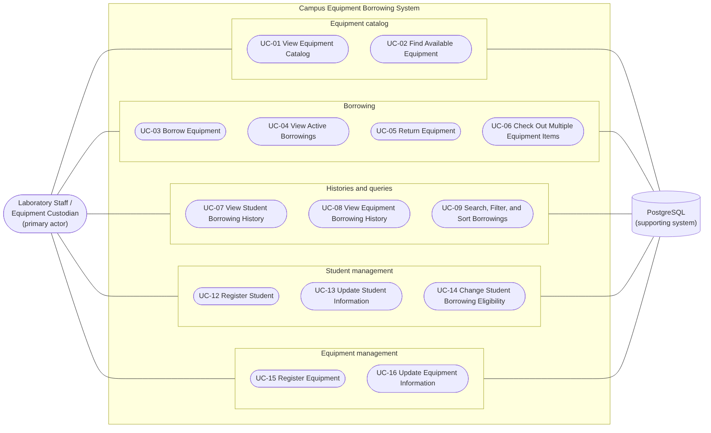

# Use-Case Diagram (Laboratory Activity 4)

**Reading the diagram**
- The **primary actor** of all fourteen cases is *Laboratory Staff / Equipment Custodian* (the "custodian").
- **PostgreSQL** is the supporting system for every case. It is shown once, on the system boundary.
- No include or extend relationships are drawn. Validation, revalidation and transaction handling are internal to each case, not separate use cases (Lab 4, Section V).
- Students do not interact with the system directly (no student self-service in Lab 4).

**Scope classification**

| Classification | Cases |
|---|---|
| Required continuation (implemented) | UC-01, UC-02, UC-03, UC-04, UC-05 |
| Required new (implemented) | UC-06, UC-07, UC-08, UC-09, UC-12, UC-13, UC-14, UC-15, UC-16 |
| Deferred to Laboratory Activity 5 (not implemented) | UC-10, UC-11, UC-17 – UC-27 |
| Future scope (not implemented) | UC-28 – UC-33 |

Detailed tables: [Use-Case-Suite.md](Use-Case-Suite.md). Mermaid source for the figure: [uc.mmd](uc.mmd).
